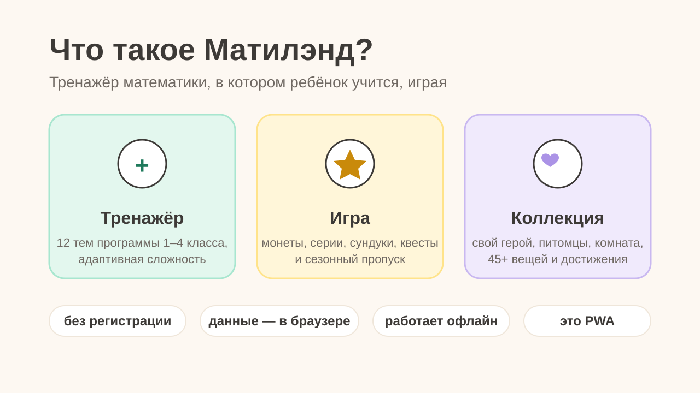
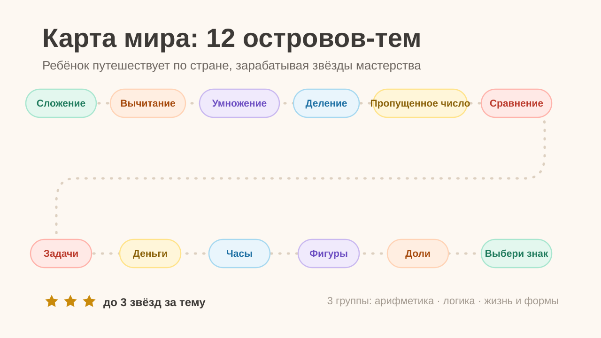
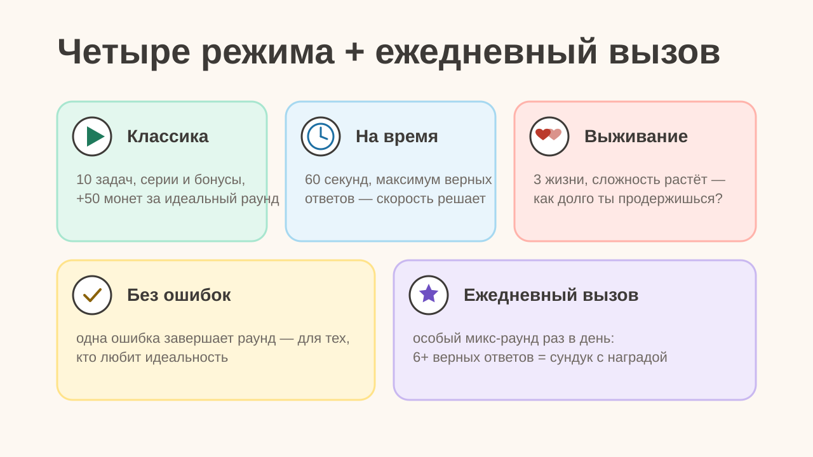
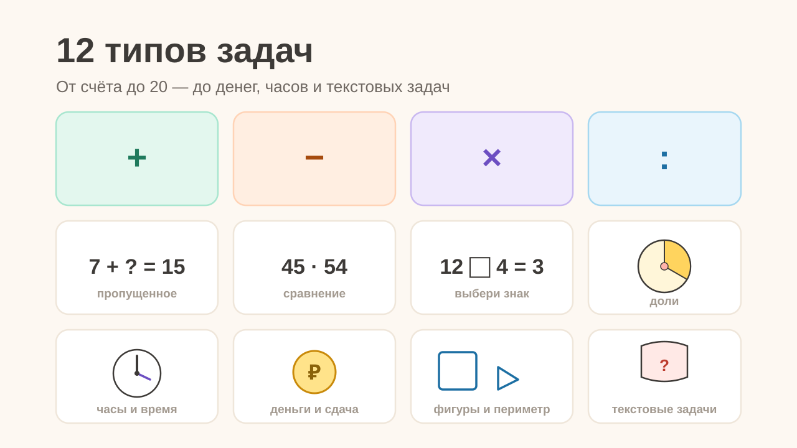
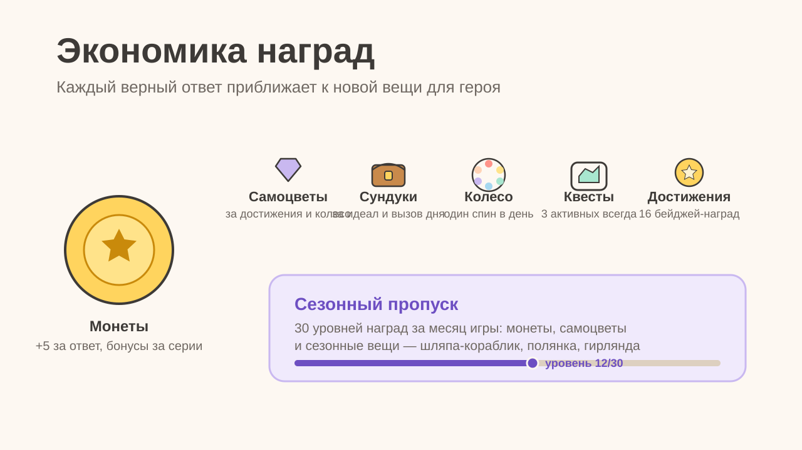
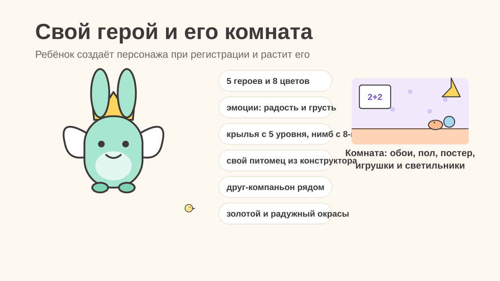
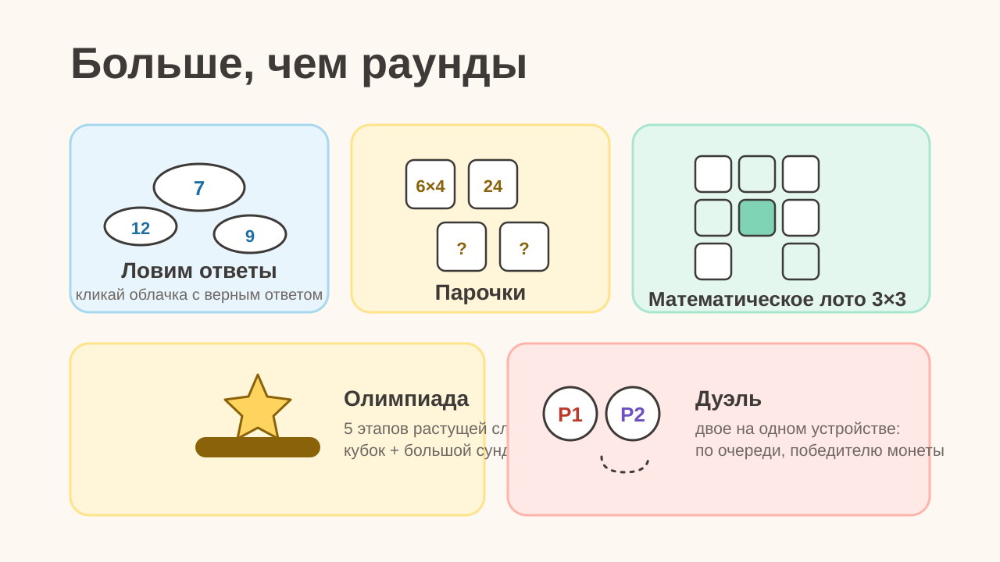
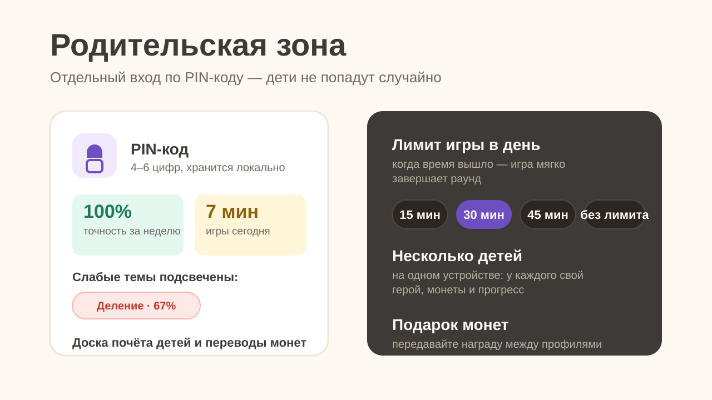
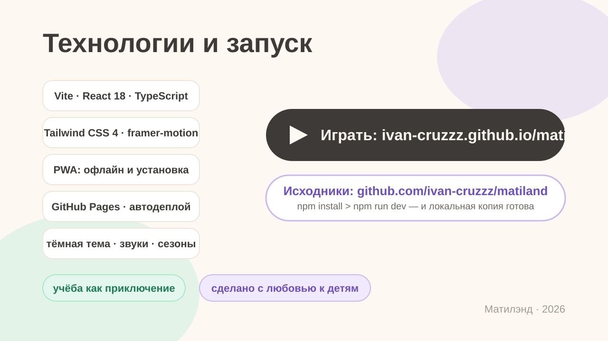

# Матилэнд — весёлая математика

Игровой сайт обучения математике для детей 1–4 класса: карта мира с темами, тренажёры с монетами,
магазин вещей для героя, комната героя, мини-игры, олимпиада, дуэль, помощник Умня
и родительская зона с лимитом времени. Все данные хранятся локально в браузере (localStorage).

## Презентация

Короткий обзор проекта — 10 слайдов. PDF-версия: [docs/presentation.pdf](docs/presentation.pdf)

<p align="center"></p>
<p align="center"></p>
<p align="center"></p>
<p align="center"></p>
<p align="center"></p>
<p align="center"></p>
<p align="center"></p>
<p align="center"></p>
<p align="center"></p>
<p align="center"></p>

## Видео

Демонстрация сайта вживую:


## Возможности

- **Режимы игры**: классика, «На время», «Выживание», «Без ошибок», ежедневный вызов
- **12 типов задач**: арифметика, пропущенное число, сравнение, выбор знака, доли,
  периметр, часы, деньги, текстовые задачи
- **Экономика**: монеты, самоцветы, квесты, достижения, сундуки, колесо удачи,
  сезонный пропуск на 30 уровней
- **Персонаж**: 5 базовых героев, эмоции, рост с уровнем, свой питомец из конструктора,
  друг-компаньон, редкие окрасы, комната с обстановкой
- **Родительская зона** (`/parent`): PIN-код, статистика, лимит времени, доска почёта,
  переводы монет между профилями

## Запуск

```bash
npm install
npm run dev      # дев-сервер на http://localhost:5173
npm run build    # продакшен-сборка в dist/ (+ PWA-сервис-воркер)
npm run preview  # предпросмотр сборки
```

## Деплой

При push в `main` GitHub Actions собирает проект и публикует его на GitHub Pages
(адрес: `https://<user>.github.io/<repo>/`). Сборка выполняется с базовым путём
репозитория, SPA-маршруты работают через фолбэк `404.html`.

## Стек

Vite · React 18 · TypeScript · Tailwind CSS 4 · framer-motion · lucide-react ·
Radix Dialog · vite-plugin-pwa. Дизайн-система — адаптация miniDESIGN в тёплой пастели.
